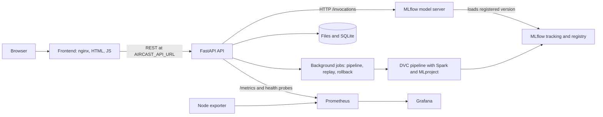
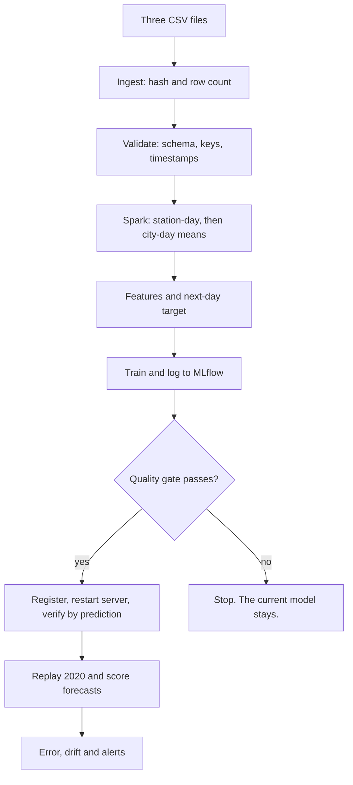

# Architecture and high-level design

## Problem

For a city and a date D, AirCast forecasts the city AQI on the next calendar day, D + 1. It uses only data up to the end of day D. The baseline is persistence: AQI(D + 1) = AQI(D).

| Period | Target dates | Use |
|---|---|---|
| Training | 2015 to 31 Dec 2018 | Fit the model |
| Validation | 2019 | Quality gate and baseline comparison |
| Replay | 1 Jan to 30 Jun 2020 | Simulated live use |

`params.yaml` sets these dates, the cities and the gate.

## Architecture diagram

| Block | Compose service | Function |
|---|---|---|
| Frontend | `frontend` | nginx serves the HTML, CSS and JavaScript over HTTPS and sends `/api` to the API. It contains no model code. |
| API | `api` | FastAPI. It validates requests, reads the feature row, calls the model server, stores forecasts and runs background jobs. |
| Pipeline | in `api` | DVC stages: ingest, validate, Spark transform, train, evaluate. `scripts/ci.sh` runs lint, tests and `dvc repro`. |
| Model server | `model-server` | `mlflow models serve` with the deployed version. A supervisor restarts it when the deployment changes. |
| MLflow | `mlflow` | Experiment tracking and the model registry. |
| Prometheus | `prometheus` | Scrapes the API every 2 s and the other targets every 5 s. It evaluates 5 alert rules. |
| Grafana | `grafana` | Shows 18 provisioned panels. |
| Node exporter | `node-exporter` | Host CPU and memory metrics. |
| Storage | files | `data/`, `artifacts/` and `state/` (with a SQLite forecast store). DVC copies data and outputs to the local remote `../aircast-dvc-store`. |

The frontend and the backend are separate containers. The browser uses only REST, at `AIRCAST_API_URL`. The API calls the model only over HTTP, at `MODEL_SERVER_URL`. All services run locally with Docker Compose. There is no cloud service.

## High-level design: data and model flow

1. **Ingest** records the SHA-256, the size and the row count of each CSV.
2. **Validate** stops the pipeline if a column is missing, a key is duplicated or a timestamp is bad. It reports the missing values.
3. **Transform** runs in local Spark. A broadcast join adds the city to each of the 2.59 million hourly rows. Negative readings become missing. A station-day mean needs 8 valid hours. The city-day mean gives each station the same weight.
4. **Features** are the AQI on D, D - 1 and D - 7, and the 7-day mean. Other features are the pollutant means, the month, the weekday and the station count. The target is the AQI on calendar day D + 1. A full date grid keeps missing days as gaps, so "D - 1" is always the previous calendar day.
5. **Train** fits a `HistGradientBoostingRegressor` and logs it to MLflow. The split uses the target date, so no future label goes into training.
6. **Evaluate** applies the gate: at least 30 validation rows, finite predictions from 0 to 1,000, and MAE of 150 or less. If the gate fails, the pipeline stops and the current model stays in service.
7. **Deploy** registers the model and writes `state/deployment.json`. The supervisor restarts the model server. A real prediction must return the expected MLflow run ID. Only then does the `champion` alias move. If the check fails, the previous model comes back. Rollback uses the same steps.

Each deployed version keeps its own copy of its features and drift reference. Thus a rejected candidate cannot change the inputs of the model in service.

The Operations page draws the pipeline graph from `dvc dag`. The dashed deploy step runs only after CI passes. Deployment is outside DVC, so a fully cached run still checks the model in service.

## Replay and monitoring

The application has one simulated date. For each simulated day, the replay:

1. Shows the actual AQI for the forecasts that are now due, and calculates their error.
2. Makes the forecast for tomorrow for each city.
3. Calculates the drift for each city: |mean AQI of the last 30 days - training mean for that month| / training standard deviation. An alert starts above 1.0.

The API exposes three types of metric:

- Request count and latency, from a middleware.
- Health and response time of each service, from a probe every 5 s. This covers nginx and MLflow, which have no metrics endpoint.
- Stage time and throughput, missing data, forecast error, drift and the model version, read from saved state at each scrape.

## Limits

- One machine and one background job at a time. A second job gets `409`.
- The replay uses recorded 2020 data. It is not a live feed.
- The certificate is self-signed. Traffic inside Compose is HTTP on a private network.
